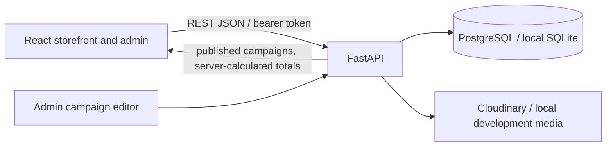

# RZ Custom Tailor — UI and system blueprint

Version 1.0 · 5 November 2026

## Design direction

Use the supplied navy, ivory, gold RZ identity and the existing RZ logo/address. Keep the public site elegant and editorial. Seasonal campaign artwork may use restrained red/green accents, but it must not replace the core brand. The supplied posters are campaign references, not product pricing data. Do not put offer terms into the logo or bake all poster text into an image; use editable HTML copy so mobile users can read it and screen readers can announce it.

## Public storefront structure

```text
┌────────────────────────────────────────────────────────────────┐
│ RZ logo    Home  Shop  Custom Tailoring  About  Contact  Bag   │
├────────────────────────────────────────────────────────────────┤
│ ACTIVE CAMPAIGN (only when published and in its date window)    │
│ campaign label · editable message · [Shop offer]                │
├────────────────────────────────────────────────────────────────┤
│ HERO: RZ headline + [Shop] [Book fitting] · tailor taking      │
│       the customer's suit measurement (replaceable fitting art) │
├────────────────────────────────────────────────────────────────┤
│ CURRENT OFFERS: Black Friday · Christmas · Eid · custom cards   │
│   Offer title / approved discount / end date / [Shop offer]     │
├────────────────────────────────────────────────────────────────┤
│ Tailoring · Alterations · Premium fabrics · appointment         │
├────────────────────────────────────────────────────────────────┤
│ Shop by category: Suits | Blazers | Coats | Overcoats | Fabric  │
├────────────────────────────────────────────────────────────────┤
│ Featured products (real API products and prices)                │
├────────────────────────────────────────────────────────────────┤
│ Custom fit / fabric / size options + booking CTA                │
├────────────────────────────────────────────────────────────────┤
│ Reviews (approved only) · Address/map · Phone · Email · Social  │
└────────────────────────────────────────────────────────────────┘
```

The offer ribbon sits immediately under navigation, and the separate Current Offers cards sit immediately after the tailor-measuring hero. This gives active offers strong visibility without replacing the fitting story. On mobile, the ribbon stays concise and offer cards become a swipeable row with readable text and one CTA each. Product selection, cart and checkout stack vertically; product lists may scroll horizontally only inside their table/card area.

## Admin navigation and key screens

```text
Navy sidebar: Overview · Products · Categories · Offers · Orders
              Appointments · Media · Store settings

Offers screen:
[New campaign]
┌───────────────────────────────────────────────────────────────┐
│ Title / event       Status       Date window       Edit       │
│ Black Friday        Scheduled    Nov 27–Nov 30     …          │
│ Christmas / Dec     Draft        Dec 01–Dec 31     …          │
│ Eid al-Fitr         Draft        set by owner      …          │
└───────────────────────────────────────────────────────────────┘

Campaign editor:
Basics: name, public title, message, badge, desktop/mobile banner
Discount: percent or fixed amount, qualifying products/categories
Schedule: start date, end date, status, priority
Button: label, safe destination, preview
[Save draft] [Publish]
```

Campaign forms explain that the discount is applied in checkout only to the selected products/categories. Existing regular product sale prices remain the base price; the API applies one eligible campaign discount and never stacks campaigns. The owner sets campaign dates, terms and amount. No 50% value is prefilled.

## System boundaries



React owns presentation and form state. FastAPI/Pydantic owns validation, authorization, campaign eligibility and final prices. SQLAlchemy models and Alembic migrations own persistent records. The browser never decides the checkout price. Campaign list edits require admin authorization; only published/in-window campaigns are public.

## Project structure

```text
rz-custom-tailor/
├── src/
│   ├── components/        # Store header, campaign banner, product card, form controls
│   ├── layouts/           # Store and protected admin shells
│   ├── pages/             # Home, shop, cart, admin login
│   ├── features/          # products, offers, orders, appointments, settings
│   ├── services/          # typed REST client
│   ├── styles/            # navy/ivory/gold design system and responsive rules
│   └── utils/             # formatting and product slugs
├── backend/app/
│   ├── api/               # REST routers (future extraction from main.py)
│   ├── models/            # SQLAlchemy entities
│   ├── schemas/           # Pydantic request/response validation
│   ├── services/          # campaign pricing, order/appointment rules
│   ├── security/          # admin auth and authorization
│   └── storage/           # local/Cloudinary media adapters
├── backend/alembic/       # versioned schema changes
├── docs/                  # blueprint, setup, deployment, QA, owner guides
└── scripts/               # Windows setup/bootstrap helpers
```

The existing source keeps some modules in compact files; this map is the target boundary for continued refactoring without changing the selected React/FastAPI/PostgreSQL architecture.

## Release checklist

1. Configure the admin account, strong secret, PostgreSQL, Cloudinary and allowed production origin.
2. Run Alembic migrations on the production database before serving the new frontend.
3. Upload owner-approved campaign artwork and enter verified terms/dates in Admin → Offers.
4. Test sample cart totals on eligible and ineligible products; confirm no campaign stacking.
5. Build and deploy the frontend/API, attach the Cloudflare-managed domain to the Hostinger deployment, configure HTTPS and backups.
6. Verify order/appointment/email notification policies and business operating details before accepting customers.

A ZIP can include the code, but cannot configure private Cloudflare/Hostinger accounts by itself. A production launch still needs the owner's hosting/database/storage credentials and a verified deployment run.
